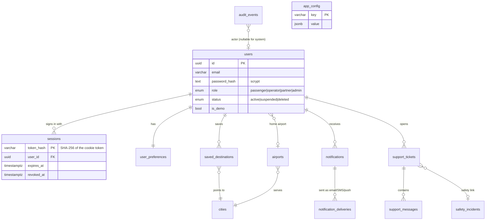
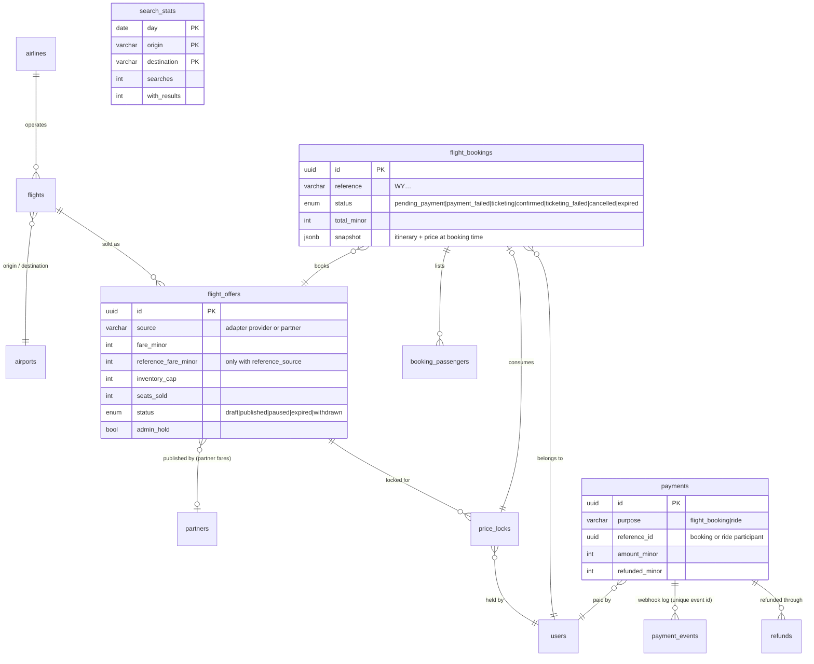
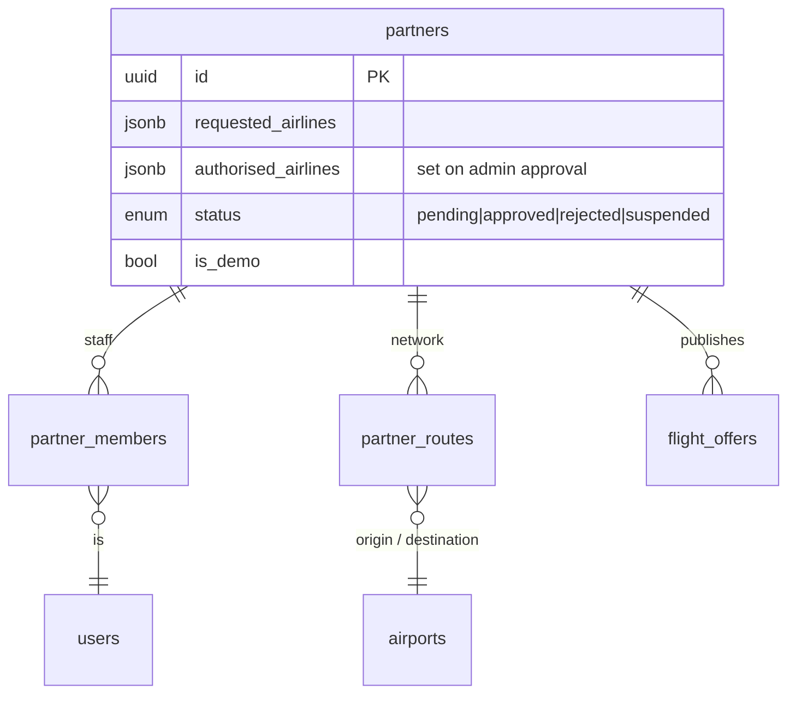

# Data model

The source of truth is [`apps/api/src/db/schema.ts`](../apps/api/src/db/schema.ts). Migrations live in [`apps/api/drizzle/`](../apps/api/drizzle) (0000–0013). Conventions:

- Primary keys are UUIDs (`gen_random_uuid()`), except reference tables keyed by code (`cities`, `airports` by IATA, `airlines` by designator) and `search_stats` (day + route).
- Money columns end in `Minor` and hold integer paise. Currency is INR.
- Every timestamp is `timestamptz` (UTC). Reporting days are converted to IST in queries.
- Personal data lives in `users`, `booking_passengers`, `flight_bookings.contact_*`, `drivers`, `support_*` and uploaded files. Analytics tables never hold any of it.

The diagrams split the model into four areas. Arrows read "many → one".

## Accounts, platform and support

## Flights, payments and refunds

`payments.reference_id` is polymorphic (a flight booking or a ride participant, by `purpose`), so it has no database foreign key; the service layer enforces it.

## Shared rides and fleet operators

```mermaid
erDiagram
  pickup_zones }o--|| airports : "at"
  ride_requests }o--|| users : "made by"
  ride_requests }o--|| pickup_zones : "pickup at"
  ride_requests }o--o| flights : "tracks"
  ride_requests }o--o| flight_bookings : "linked booking"
  ride_groups }o--|| pickup_zones : "pick up at"
  ride_groups ||--o{ ride_participants : "carries"
  ride_participants }o--|| ride_requests : "from"
  operators ||--o{ operator_members : "staff"
  operator_members }o--|| users : "is"
  operators ||--o{ drivers : employs
  operators ||--o{ vehicles : owns
  operators ||--o{ operator_documents : "uploads"
  operators ||--o{ availability : "offers shifts"
  availability }o--|| drivers : "driver"
  availability }o--|| vehicles : "vehicle"
  ride_groups ||--o| ride_trips : "assigned as"
  ride_trips }o--|| operators : "run by"
  ride_trips }o--|| drivers : "driven by"
  ride_trips }o--|| vehicles : "in"
  ride_trips }o--o| settlements : "paid out in"
  ride_groups ||--o{ trip_releases : "released by operators"
  safety_incidents }o--o| ride_groups : "about"
  safety_incidents }o--o| operators : "involving"
  settlements }o--|| operators : "for"
```

## Airline and distribution partners

## Integrity rules enforced in the database

- **Unique:** user email (the API lower-cases emails before storing them), booking reference, one booking per price lock, booking idempotency key per user, refund idempotency key, provider payment intent, `payment_events` (provider, event id) so webhook replays are ignored, flight operation (airline, number, departure), offer (source, external ref), vehicle registration, support ticket reference, partner route (partner, origin, destination). A user belongs to at most one operator and at most one partner.
- **Partial unique indexes:** a ride request can be in only one active group (`joined`, `payment_due` or `confirmed`); a user can have only one open or matched ride request per airport and arrival time.
- **One trip per group:** `ride_trips` is keyed by `group_id`.
- **Checks:**
  - Offers: fare > 0 and 0 ≤ taxes ≤ fare; seats sold never exceed the inventory cap.
  - Price locks: total = fare × adults.
  - Payments and refunds: 0 ≤ refunded ≤ amount paid; refund amounts > 0.
  - Ride groups: seats and luggage never exceed capacity.
  - Ride participants: current price ≤ the maximum the rider agreed.
  - Settlements: payout = gross − commission.
  - Times and routes: arrival after departure, shift end after start, partner routes have distinct ends.
